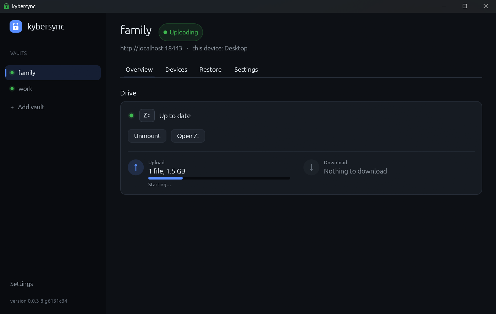
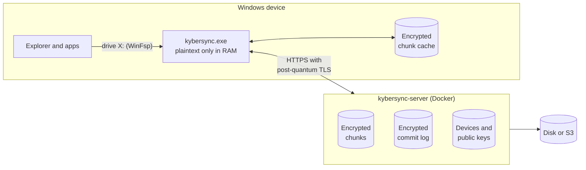
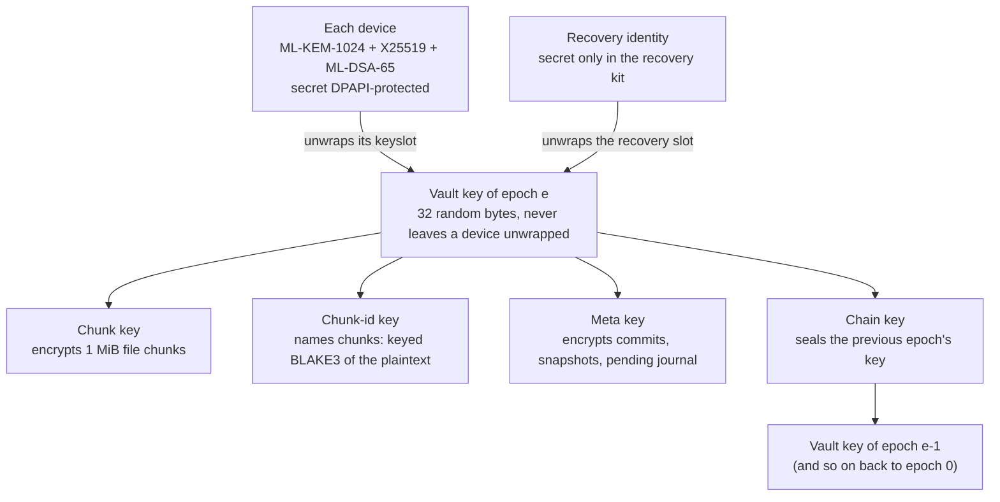

# kybersync

**End-to-end encrypted, post-quantum safe file sync for Windows.** It's an encrypted drive that
stays in sync across all your devices, with a self-hosted server that never sees a key.

<p align="center">
  
</p>

* **It's a real drive.** Each vault mounts as a drive letter (via [WinFsp](https://winfsp.dev)),
  so Explorer and every app work with it as usual.
* **Encrypted on the device.** File contents, names, folder structure and timestamps are encrypted
  before they leave your PC. Plaintext only ever exists in memory.
* **Post-quantum from end to end.** Key exchange, device authentication and transport all use the
  NIST post-quantum standards, combined with classical algorithms.
* **A server that can't read anything.** The server stores opaque blobs and an encrypted log on
  disk or in any S3-compatible bucket. It holds no keys.
* **Multi-device sync.** Changes usually arrive in under a second. Offline edits are kept and
  sent later, and conflicting edits keep both versions.
* **Device control.** New devices join with a one-time invite and a fingerprint check. Revoking
  a device rotates the vault key.
* **Trash.** Deleted files can be restored for 7 days by default.

## How it works



* **Client** (`kybersync.exe`) is a single native Windows exe written in Rust. It mounts each
  vault, encrypts locally, syncs in the background and lives in the notification area.
* **Server** (`kybersync-server`) is written in Rust and ships as a small (~55 MB) distroless
  Docker image. It orders commits and stores blobs, and it can't decrypt either.

Files are split into 1 MiB chunks. Each chunk is encrypted and stored under a keyed hash, so an
edit only uploads the chunks it changed. Every change (write, rename, delete and so on) becomes an
encrypted **commit** in the vault's log. The server only numbers the commits. Every client replays
the log with the same deterministic rules, so all devices end up with the same files without the
server understanding any of it.

## Cryptography

| Purpose                                  | Algorithm                                        |
|------------------------------------------|--------------------------------------------------|
| File contents, metadata, local state     | XChaCha20-Poly1305, 256-bit keys, random nonces  |
| Subkey derivation                        | BLAKE3 `derive_key` with domain separation       |
| Chunk names (dedup)                      | keyed BLAKE3, so the server can't test guesses   |
| Wrapping the vault key for each device   | **hybrid ML-KEM-1024 + X25519** (X-Wing-style combiner) |
| Device → server authentication           | **ML-DSA-65** challenge/response signatures      |
| Recovery kit                             | Argon2id (256 MiB, t=3, p=4) over a recovery identity (hybrid KEM + ML-DSA-65) |
| Key rotation (revocation)                | new random key per epoch; older keys chained, sealed under the newer one |
| Transport                                | rustls / aws-lc-rs with hybrid **X25519MLKEM768** key exchange |
| Device secret at rest                    | Windows DPAPI (bound to the Windows user)        |

Every algorithm here is post-quantum safe. Symmetric 256-bit keys keep at least 128-bit security
against Grover's algorithm. The asymmetric parts use the NIST PQC standards (FIPS 203 and 204).
Key wrapping is hybrid with X25519, so an attacker has to break both ML-KEM and X25519.

### Key hierarchy



A *keyslot* is the current vault key wrapped to one device's hybrid KEM public key. The
*recovery slot* is the same for the recovery identity, plus a MAC that binds it to the key.

* **Joining.** A new device presents a one-time invite code from an existing device. That device
  compares fingerprints and then wraps the vault key to the new device's public keys. The server
  never handles a plaintext key.
* **Revocation.** Revoking a device generates a fresh vault key for the next epoch. The new key
  is wrapped to every remaining device and to the recovery identity, and the old key is sealed
  under it. The server then refuses anything written in the old epoch. Devices accept a new key
  only if its chain leads back to the key they already hold, so the server can't slip in a key
  of its own.
* **Recovery kit.** The kit holds a password-protected recovery identity, not the vault key, so
  it survives key rotations. Only the current kit can replace itself, so a single compromised
  device can never lock the owner out.
* **Tamper-evident history.** Each commit is sealed with its log position and the hash of the
  record before it. If the server reorders, drops or splices records, devices notice and stop
  syncing instead of following it.

### What the server sees

| The server **cannot** see | The server **can** see |
|---|---|
| File contents | Vault names, device names and public keys |
| File and folder names | Number and timing of commits |
| Folder structure | Approximate sizes (chunk counts, commit lengths) |
| Timestamps | When the same chunk appears twice within a vault (dedup) |

A malicious server can't forge or reorder records without being caught. It can still withhold
data: serve an old state, or keep two devices on separate histories until they see each other's
changes again.

## Run the server with Docker

You need Docker and a host the devices can reach. The image is published as
`ghcr.io/coronabytes/kybersync`.

**1. Create an admin token.** It's only needed to create vaults, so keep it private:

```bash
openssl rand -hex 24
```

**2. Create a `compose.yml`:**

```yaml
services:
  kybersync:
    image: ghcr.io/coronabytes/kybersync:latest
    restart: unless-stopped
    ports:
      - "8443:8443"
    environment:
      KYBERSYNC_ADMIN_TOKEN: ${KYBERSYNC_ADMIN_TOKEN:?set KYBERSYNC_ADMIN_TOKEN}
      KYBERSYNC_STORAGE: fs
      # Let the server terminate TLS itself (hybrid post-quantum key exchange):
      # KYBERSYNC_TLS_CERT: /certs/fullchain.pem
      # KYBERSYNC_TLS_KEY: /certs/privkey.pem
    volumes:
      - kybersync-data:/data
      # - ./certs:/certs:ro

volumes:
  kybersync-data:
```

**3. Start it:**

```bash
KYBERSYNC_ADMIN_TOKEN=<your token> docker compose up -d
```

**4. Add HTTPS.** Clients only accept plain `http://` for `localhost`. For anything else, either
mount a certificate and set `KYBERSYNC_TLS_CERT` / `KYBERSYNC_TLS_KEY` (shown above), or put a
reverse proxy in front. Built-in TLS always uses the hybrid **X25519MLKEM768** key exchange. If
you use a proxy, make sure it supports it too, or the transport layer won't be post-quantum.
For example, with Caddy:

```
sync.example.com {
    reverse_proxy kybersync:8443
}
```

Devices then connect to `https://sync.example.com`.

### Store data in S3

Instead of a local volume, the server can use any S3-compatible bucket (AWS S3, Cloudflare R2,
MinIO, SeaweedFS and others). The bucket must support conditional writes (`If-None-Match: *`).
Run only one server instance per bucket.

```yaml
    environment:
      KYBERSYNC_ADMIN_TOKEN: ${KYBERSYNC_ADMIN_TOKEN:?set KYBERSYNC_ADMIN_TOKEN}
      KYBERSYNC_STORAGE: s3
      KYBERSYNC_S3_BUCKET: kybersync
      AWS_ENDPOINT: https://<account>.r2.cloudflarestorage.com
      AWS_REGION: auto
      AWS_ACCESS_KEY_ID: ...
      AWS_SECRET_ACCESS_KEY: ...
```

[`src/compose.yml`](src/compose.yml) has a complete example with a local SeaweedFS
(`docker compose --profile s3 up -d`).

### Settings

| Variable                           | Default        | Meaning                                              |
|------------------------------------|----------------|------------------------------------------------------|
| `KYBERSYNC_ADMIN_TOKEN`            | random, logged | needed only to create vaults                         |
| `KYBERSYNC_LISTEN`                 | `0.0.0.0:8443` | listen address                                       |
| `KYBERSYNC_STORAGE`                | `fs`           | `fs` or `s3`                                         |
| `KYBERSYNC_DATA_DIR`               | `/data`        | root directory for `fs`                              |
| `KYBERSYNC_S3_BUCKET`              | –              | bucket for `s3` (plus the `AWS_*` variables)         |
| `KYBERSYNC_TLS_CERT` / `_KEY`      | –              | PEM files; enables built-in TLS                      |
| `KYBERSYNC_TRASH_DAYS`             | `7`            | how long deleted files stay restorable (0: no trash) |
| `KYBERSYNC_RATE_LIMIT_PER_MINUTE`  | `30`           | per-IP limit on routes that need no credentials (0: off) |
| `KYBERSYNC_COMPACT_AFTER`          | `1000`         | commits after the latest snapshot that make compaction due (0: never) |
| `KYBERSYNC_GC_INTERVAL_HOURS`      | `24`           | how often unused chunks are cleaned up (0: never automatically) |
| `KYBERSYNC_GC_GRACE_HOURS`         | `168`          | unused chunks younger than this are kept (min 1) |
| `KYBERSYNC_SWEEP_INTERVAL_MINUTES` | `10`           | server housekeeping interval                         |
| `KYBERSYNC_UPDATE_CHECK`           | `true`         | log at startup (and daily) when a newer release is on GitHub |

### Updating the server

The server logs its version at startup and checks GitHub for a newer release. When one exists,
it logs a warning with the image tag to pull. To update, pull the new image and recreate the
container:

```bash
docker compose pull && docker compose up -d
```

## Set up the client

1. Install [WinFsp](https://winfsp.dev/rel/) and download `kybersync-…-windows-x64.zip` from the
   [latest release](https://github.com/coronabytes/kybersync/releases/latest).
2. Start `kybersync.exe` and choose **Add vault → Create a new vault**. Enter the server URL, a
   vault name, the admin token and a password for the **recovery kit**. The vault mounts right
   away.
3. Keep the recovery kit file somewhere safe and offline. With its password, it's the only way
   back in if every device is lost, and the password can't be reset.
4. To add another device, open the vault's **Devices** tab and click **Invite a device**. Then
   open the invite on the new device under **Add vault → Join an existing vault**, and approve it
   on the first device once the fingerprints match.

The vault's **Restore** tab brings back deleted files, and **Settings → Start with Windows** keeps
the app running in the notification area.

**Updates.** The app checks GitHub for a new release at startup and once a day. When one is
out, the tray menu and the sidebar say so. **Settings → Updates → Install and restart** downloads
the release zip, checks it against the SHA-256 that GitHub recorded, puts the new `kybersync.exe`
in place of the running one and restarts. **Download zip** fetches the zip in the browser
instead. Automatic checks can be turned off in the same section.

## License

[AGPL-3.0-or-later](LICENSE). If you run a modified version of kybersync as a network service,
you must offer its source code to the users of that service.

The client links WinFsp and winfsp-rs, which are GPLv3 (WinFsp offers a FLOSS exception and
commercial licensing). GPLv3 and AGPLv3 explicitly allow being combined.
